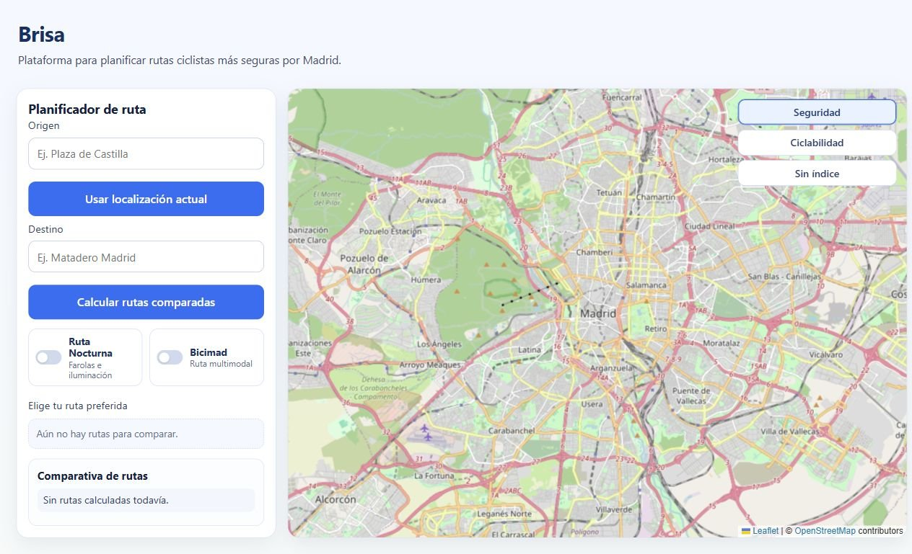
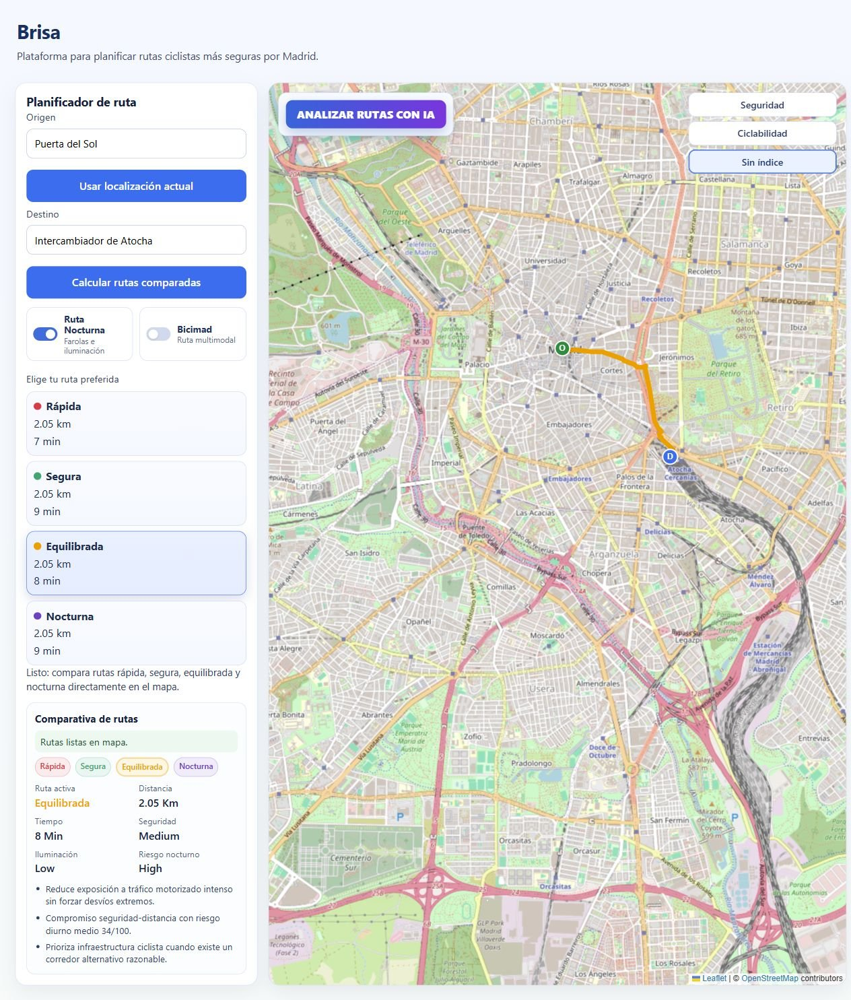
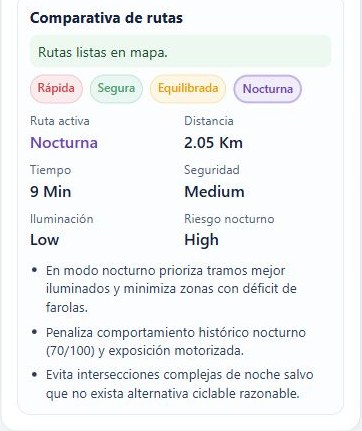
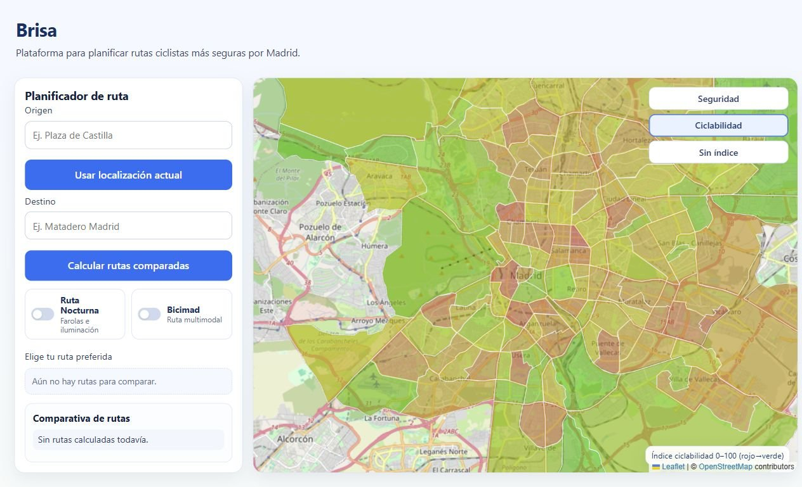
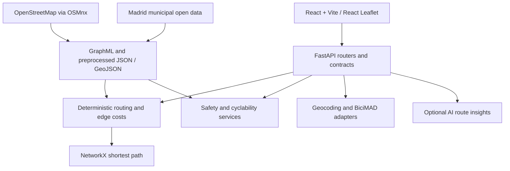

# Brisa

**A cycling route planner for Madrid that makes the trade-off between distance, road risk, and nighttime conditions visible.**

The shortest way across a city is not always the route you want to cycle. Brisa combines an OpenStreetMap street graph with Madrid's municipal open data to compare alternatives, show the signals behind them, and help riders make an informed choice.

**[Open Brisa](https://brisa-madrid.vercel.app)** · **[Watch the product walkthrough — Spanish, 2:54](https://www.loom.com/share/394337e4a7da452c9a4c78ba2a633dac)** · [Routing mathematics](docs/routing-model.md) · [Local setup](#running-locally)

Four routing profiles · Safety and cyclability maps · BiciMAD walking/cycling legs · Address suggestions · Optional AI explanations

[Explore](#what-you-can-explore) · [Routing](#how-routing-works) · [Architecture](#architecture) · [Data](#data-and-neighborhood-analysis) · [Setup](#running-locally) · [Tests](#tests-and-current-limitations)

**Built with:** React 18, Vite, React Leaflet, FastAPI, OSMnx, NetworkX, Shapely, and pyproj. The current application interface is in Spanish.




*The live planning interface, 21 October 2026, with OpenStreetMap tiles. Real route results and score views are shown below.*


## See it in action

The [recorded walkthrough](https://www.loom.com/share/394337e4a7da452c9a4c78ba2a633dac) is in **Spanish**: project motivation at 0:00, open data and safety at 0:48, and route comparison at 1:38. Routing and scoring are implemented in Python; the map displays returned GeoJSON rather than fabricated paths.



*Production run: Puerta del Sol → Intercambiador de Atocha. All four profiles completed and displayed 2.05 km; their assumed-speed duration estimates differ. Profiles need not produce distinct routes.*

A separate, longer hosted comparison from **Plaza de Castilla → Paseo de la Chopera** returned:

| Profile | Displayed distance | Displayed estimated duration |
| --- | ---: | ---: |
| Fastest | 9.15 km | 31 min |
| Safe | 11.66 km | 50 min |
| Balanced | 9.27 km | 35 min |
| Night | 9.27 km | 43 min |

These are observations from one run, not performance benchmarks. A repeat returned only three profiles; partial failures are recorded in the verification report. Durations use fixed profile speeds, and identical rounded distances do not establish identical geometries.

<details>
<summary>Night profile and neighborhood cyclability captures</summary>



*A crop of the actual night-route summary. It reports lighting quality and nighttime risk; it does not promise a well-lit path when the available evidence is unfavorable.*



*The cyclability map colors real neighborhood polygons using the computed index.*

</details>

[Capture provenance and verification results](docs/verification.md) explain what was exercised and what remains unverified.

Brisa was submitted to **Madrid's 2026 Open Data Reuse Awards**. Competition results have not been confirmed.

## What you can explore

| Capability | What the implementation does |
| --- | --- |
| Compare routes | Calculates `fastest`, `safe`, and `balanced` independently; optionally includes `night`. Overlays alternatives and shows distance, estimated duration, and qualitative risk/lighting labels. Profiles can return the same path. |
| Understand trade-offs | Returns deterministic explanations and evidence-bearing hazard points for complex junctions, nearby severe cycling incidents, and low-cyclability neighborhoods. |
| Explore safety | Displays a municipal-data safety layer, aggregated to neighborhoods by default, with cell-level GeoJSON also available through the API. This is a separate model from edge routing risk. |
| Explore cyclability | The main screen displays the cyclability choropleth. The API also exposes rankings, detail, comparison, and score breakdowns; a standalone ranking/comparison component exists but is not mounted in the current app shell. The index includes explicit heuristic adjustments. |
| Plan with BiciMAD | Builds `walk → bike → walk` legs using nearby stations and separate walking/cycling graphs. **Station choice is proximity-based; live bike/dock availability is not used.** |
| Find addresses | Uses Nominatim suggestions; selected coordinates avoid repeating geocoding during routing. Map clicks can set endpoints, and browser geolocation can set the origin. |
| Request AI insights | An optional, on-demand OpenAI integration describes already computed alternatives. It does not choose graph paths or calculate safety scores. |

## How routing works

1. **Build the network.** OSMnx downloads Madrid with `graph_from_place(..., simplify=True)`. The default base network is `all`; Brisa then filters it with its cycling-access rules. A separate `walk` graph supports BiciMAD access legs. GraphML files persist both networks.
2. **Attach evidence to edges.** Sampled street geometry is matched to nearby municipal records in a metric coordinate system. Road tags, traffic, incidents, crossings, lighting, and cycling activity become cached edge metrics.
3. **Apply a profile.** Each directed edge receives one cost per routing mode. All modes share the filtered network; their cost functions express different preferences.
4. **Find a path.** Endpoints snap to graph nodes. `networkx.shortest_path(..., weight=...)` minimizes the sum of edge costs; the cheapest parallel edge supplies geometry and metrics.
5. **Explain the result.** The API returns GeoJSON, distance, qualitative summaries, deterministic text, and hazard evidence. React requests alternatives separately and retains successful profiles if others fail.

For graph $G=(V,E)$, snapped endpoints $s,t$, and profile $m$:

```math
P_m^* = \arg\min_{P:s\leadsto t}\sum_{e\in P}w_m(e)
```

This is scalarized multi-criteria shortest-path routing. It does not enumerate a Pareto frontier, impose a maximum detour, or guarantee distinct alternatives.

### Edge costs

Let $L(e)$ be length in meters, $H(e)$ road hostility, $R(e)$ daytime risk, $D(e)$ lighting deficit, and $N(e)$ composite nighttime risk. The four scores are clipped to $[0,1]$; larger values mean a less favorable segment.

The defaults in [routing_profiles.py](backend/app/core/routing_profiles.py), applied by [RouteService](backend/app/services/route_service.py), are:

```math
\begin{aligned}
w_{\mathrm{fastest}}(e)&=L(e) [1+0.5\max(0,H(e)-0.85)]\\
w_{\mathrm{safe}}(e)&=L(e) [1+4.2R(e)]\\
w_{\mathrm{balanced}}(e)&=L(e) [1+2.1R(e)]\\
w_{\mathrm{night}}(e)&=L(e) [1+4.5R(e)+2.4D(e)+1.6N(e)]
\end{aligned}
```

These costs are **penalized distance, not seconds**. `fastest` is a distance-led approximation with a small extreme-hostility penalty, not true travel-time optimization. Displayed durations use assumed speeds. All six multipliers are configurable through environment variables.

### Daytime and nighttime risk

Write $c(x)=\min(1,\max(0,x))$. With the default safety weights:

```math
R=c\left(0.30H+0.25c(0.6T+0.4I)+0.12J+0.20A_g+0.08A_b-0.16B\right)
```

```math
N=c\left(R+0.28D+0.22A_n+0.20c(0.7I+0.3T)+0.10J\right)
```

| Symbol | Meaning |
| --- | --- |
| $T, I$ | Normalized nearby motor-traffic and mean daily traffic signals |
| $J$ | Junction complexity from endpoint graph degree and nearby crossings |
| $A_g,A_b,A_n$ | Clipped, smoothed general, bicycle, and nighttime incident signals |
| $B$ | Cycling bonus: $c(0.25P+0.65O+0.20X_b)$, combining cycling counts $P$, OSM infrastructure $O$, and bicycle crossings $X_b$ |
| $D$ | Lighting deficit: one minus the normalized nearby streetlight signal |

Cycling infrastructure reduces both hostility and the composite daytime score. Nighttime risk already contains daytime risk and lighting deficit, so the night edge cost deliberately counts these signals again with additional weights. The coefficient named `NIGHT_ACCIDENT_MULTIPLIER` multiplies **composite nighttime risk**, not just nighttime accidents.

These are **engineering heuristics, not statistically calibrated accident probabilities**. Nearby records are distance-decayed, averaged over a few geometry samples, divided by a fixed scale, and clipped. Missing data, recording practices, and cycling volumes affect the scores. See the [complete derivation](docs/routing-model.md) for sampling radii, smoothing, OSM infrastructure rules, defaults, and aggregation limitations.

### Why a lower-risk route can be longer

An illustrative two-corridor example, **not a measured Madrid trip**:

| Corridor | Length | Constant daytime risk | `fastest` cost, if $H\leq0.85$ | `balanced` cost | `safe` cost |
| --- | ---: | ---: | ---: | ---: | ---: |
| Direct | 1,000 m | 0.40 | 1,000 | 1,840 | 2,680 |
| Quieter | 1,400 m | 0.20 | 1,400 | 1,988 | 2,576 |

The distance-led and balanced profiles choose the direct corridor; the safe profile accepts 400 m extra because its risk penalty is larger. The safe profile minimizes penalized distance, not risk alone.

## Architecture



GIS processing stays in backend services; the frontend owns interaction and presentation. Pydantic models validate key API boundaries, while [documented contracts](docs/contracts/README.md) describe the integration. They are not a generated TypeScript client or a comprehensive runtime validator for every endpoint.

Preprocessing keeps data joins out of ordinary path search. Disk caches survive process restarts; routing memory is released after each request by default, trading lower idle memory for subsequent reload work. External station providers have snapshot fallbacks. AI failures return controlled errors while deterministic routes remain usable.

Read the [architecture guide](docs/architecture.md) for component boundaries, cache lifecycle, and failure behavior.

## Data and neighborhood analysis

The configured sources include OpenStreetMap; Madrid's general and bicycle traffic-incident records; traffic counts; streetlights; crossings; cycling counts; neighborhood boundaries; and EMT/BiciMAD station locations. Sources have different vintages and schemas: they are not a synchronized live view of the city.

The neighborhood index aggregates edge evidence mostly by length, constructs seven components, then normalizes them relative to other neighborhoods using clipped 5th/95th percentile bounds. Default component weights are safety **40**, infrastructure **18**, low hostility **14**, green cycling **10**, night **9**, junction comfort **5**, and BiciMAD access **4**. Floors and park adjustments also affect the final score, including a minimum score for two named neighborhoods. It is a relative, heuristic index.

The [data guide](docs/data-sources.md) maps every input to its consumer, configuration, fallback, and known coverage issue. In particular, some defaults point to catalog pages where the edge loader expects CSV; a configured source is not proof that it contributed records. Check generated dataset counts before interpreting a score.

## Running locally

Use **Node.js 20+**, **Python 3.11+** (NetworkX 3.5 requires it), and network access to OSM/Nominatim, Madrid/EMT data, and map tiles. Python GIS packages need compatible binary wheels or local native libraries. Allow disk space and memory for city-wide graphs and preprocessing; no hardware minimum has been benchmarked.

From the repository root, start the API:

```bash
cd backend
python3 -m venv .venv
source .venv/bin/activate
python -m pip install -r requirements.txt
uvicorn app.main:app --reload --port 8000
```

In another terminal, start the frontend from the repository root:

```bash
cp .env.example .env
npm install
npm run dev
```

Open [localhost:5173](http://localhost:5173); API documentation is at [localhost:8000/docs](http://localhost:8000/docs). On Windows, activate Python with `.venv\Scripts\Activate.ps1` in PowerShell.

The frontend reads `.env` through Vite. The basemap uses OpenStreetMap without a key; a public `VITE_CARTO_BASEMAP_API_KEY` optionally enables CARTO's light style ([configuration](docs/map-tiles.md)). The backend reads **process environment variables**; it does not automatically load `backend/.env.example` or a `.env` file. Defaults work without credentials for deterministic features. `OPENAI_API_KEY` is optional and belongs only on the backend. See [backend configuration](backend/README.md#configuration) before overriding data URLs, CORS, network type, or cache settings.

### Preprocessing and first startup

Startup precomputation is enabled by default and can be expensive. To generate artifacts explicitly, run from `backend/` with the virtual environment active:

```bash
python -m app.pipelines.build_routing_cache
python -m app.pipelines.build_safety_cache
python -m app.pipelines.build_neighborhood_cyclability
```

Artifacts live under `backend/data/graphs`, `routing`, `safety/processed`, and `cyclability`. The first startup may still rebuild them if the bootstrap fingerprint is absent. `PRECOMPUTE_CACHE_ON_STARTUP=false` skips startup warmup, **not** data requirements: missing artifacts are built on demand.

Common problems include a blocked Overpass/Nominatim request, incompatible GIS dependencies, stale caches after configuration changes, or a frontend API URL/CORS mismatch. See [troubleshooting and deployment](backend/README.md#troubleshooting) for diagnosis and cache refresh instructions.

## Tests and current limitations

```bash
npm run lint
npm run build
cd backend
python -m pip install pytest pytest-asyncio
PRECOMPUTE_CACHE_ON_STARTUP=false python -m pytest -q
```

Tests cover geocoding transformations, cycling-access rules, route responses, selected cyclability calculations/API calls, BiciMAD planning, and AI response handling. Most use fixtures or stubs; they do not validate city-wide routing or safety against external outcomes. The [verification report](docs/verification.md) records the current checks and existing failures rather than implying a green test suite.

- Safety weights and smoothing have not been externally validated. Lighting measures nearby inventory, not actual light levels or working lamps.
- Data availability, incomplete OSM tags, and stale snapshots can materially change results. The graph builder also needs explicit retention of bicycle-specific OSM attributes; current fresh-build defaults omit several tags used by scoring/access rules. Empty sources are not consistently surfaced as confidence warnings.
- Route summaries average edge scores without length weighting; the optimization itself uses length-scaled costs. The safety map and neighborhood index use different aggregation methods.
- BiciMAD uses at most one station pair within 2.2 km of each endpoint; it can miss feasible alternatives and does not check availability or operating status.
- Live comparisons can partially fail; the UI retains successful profiles. City-wide preprocessing and graph reloads can be costly. Caches are versioned but do not automatically detect every source/configuration change.
- There is no public E2E suite, external safety calibration, or measured performance benchmark in the repository.

See [known implementation issues](docs/known-issues.md) for specific findings and source references.

## Roadmap and contributing

Next priorities are data-source validation and provenance, reliable integration tests, availability-aware BiciMAD selection, explicit confidence reporting, and measured cache/runtime improvements. The [roadmap](docs/roadmap.md) separates implemented behavior from proposed work.

Contributions are welcome. Read [CONTRIBUTING.md](CONTRIBUTING.md), [the code of conduct](CODE_OF_CONDUCT.md), and [security reporting](SECURITY.md). The code is [MIT-licensed](LICENSE); upstream data and tiles retain their own terms and attribution requirements.

Further reading: [backend operations](backend/README.md) · [routing model](docs/routing-model.md) · [architecture](docs/architecture.md) · [data sources](docs/data-sources.md) · [API contracts](docs/contracts/README.md) · [historical development notes](docs/slices/README.md).
