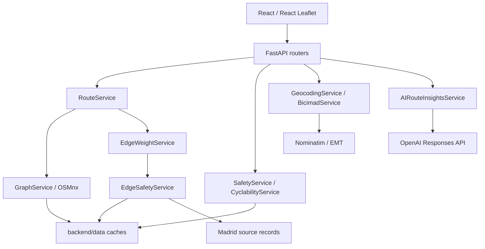

# Architecture

Brisa separates presentation, geospatial calculations, provider adapters, and documented API boundaries. The deterministic routing engine works without an AI key.

## Component map

## Frontend

- `src/app/`: entry, layout, startup checks, route comparison orchestration, and state.
- `src/features/search/`: endpoint selection and geocoding suggestions.
- `src/features/routing/`: HTTP adapters, alternative selection, summary cards, optional AI panel.
- `src/features/map/`: Leaflet tiles, GeoJSON, endpoint markers, station/hazard overlays, and viewport updates.
- `src/features/safety/` and `neighborhoods/`: layer loading, rankings, detail, and comparison components.
- `src/features/bicimad/`: station normalization, provider fallbacks, station layers.
- `src/shared/`: flags and mode definitions. Flags describe UI availability; they are not evidence that every provider-backed capability is active.
- `src/mocks/`: example locations and small fallback snapshots. These are not substitutes for an actual routing graph.

The app submits three independent `POST /api/routes` requests (`fastest`, `safe`, `balanced`) and optionally a fourth (`night`). `Promise.allSettled` lets successful alternatives survive failures in other profiles. The balanced route is initially selected when available. Summaries use returned geometry/distance, with mode-specific assumed speeds for ordinary bike durations.

React does not calculate GIS scores. Routes and layers arrive as GeoJSON. The basemap configuration uses OpenStreetMap tiles when no CARTO key is configured, or CARTO Positron with a configured public basemap key. Each choice retains the appropriate attribution. Provider access is independent of the API; see [map tiles](map-tiles.md).

## Backend

| Layer | Responsibility |
| --- | --- |
| `routers/` | HTTP handling, payload parsing, response models where declared, controlled errors |
| `schemas/` | Pydantic structures for routes, stations, health, geocoding, and safety |
| `services/` | Routing, source processing, edge signals, grid aggregation, neighborhood scoring, and AI interpretation |
| `clients/` and `utils/` | External HTTP access, provider normalization, payload parsing, GeoJSON serialization |
| `core/` | Environment configuration, profile weights, safety/cyclability settings, CORS |
| `pipelines/` | Explicit rebuild commands for heavy offline artifacts |

[API contracts](contracts/README.md) document the frontend/backend boundary. They are maintained alongside code, not generated from one schema source. Several cyclability endpoints return dictionaries rather than declared Pydantic response models; automated contract conformance is incomplete.

## Routing request lifecycle

1. Parse query/coordinate payloads and optional BiciMAD mode.
2. Resolve missing coordinates through Nominatim; otherwise use supplied coordinates.
3. Load a cached GraphML network or download/build it through OSMnx.
4. Load cached `u:v:key` metrics or build them from municipal records and OSM tags.
5. Attach profile costs, snap endpoints, and invoke NetworkX weighted shortest path.
6. Assemble the chosen parallel-edge geometries, distance, summary labels, deterministic explanations, and hazards.
7. Validate the route response; release heavy runtime caches in the router's `finally` block by default.

BiciMAD additionally loads a walking graph, selects at most one nearby station per endpoint, and constructs three legs. It does not currently call `StationStatusService` for selection. The response sets `liveStatusUsed=false`, with null bike/dock counts. Old availability-oriented strings are listed in [known issues](known-issues.md).

Hazard generation also reads cycling-incident data and cyclability/neighborhood data. A route can therefore depend on more than the graph and edge cache; preprocessing alone does not eliminate every external call.

## Three different scoring products

| Product | Unit and aggregation | Main code |
| --- | --- | --- |
| Routing risk | Nearby signals at sampled edge geometry; profile costs scale with length | `edge_safety_service.py`, `route_service.py` |
| Map safety | Default 250 m grid with independent normalized components, then neighborhood aggregation | `safety_grid_builder.py`, `safety_service.py` |
| Neighborhood cyclability | Mostly length-weighted edge aggregates, relative component normalization, weighted index and adjustments | `cyclability_service.py` |

The routing response marks `usedSafetyGrid`, `usedLightingGrid`, and `usedNightRiskGrid` false. Legacy lighting/night grid services are present but do not define the active edge-cost path. See the [routing model](routing-model.md) rather than inferring routing behavior from the map color.

## Preprocessing and cache lifecycle

| Artifact | Location | Producer |
| --- | --- | --- |
| Raw and filtered cycling graph; walking graph | `backend/data/graphs/` | `GraphService` |
| Edge metrics and configuration metadata | `backend/data/routing/` | `EdgeWeightService` / routing pipeline |
| Raw edge inputs | `backend/data/routing/raw/` | `EdgeSafetyService` |
| Safety grid, neighborhood layer, metadata | `backend/data/safety/processed/` | safety pipeline |
| Neighborhood scores, GeoJSON, metadata | `backend/data/cyclability/` | cyclability pipeline |
| Bootstrap fingerprint | `backend/data/cache/bootstrap_state_v1.json` | `BootstrapService` |
| BiciMAD location snapshot | `backend/app/data/bicimad_stations_snapshot.json` | `BicimadService`; consumed by cyclability |

`PRECOMPUTE_CACHE_ON_STARTUP` defaults to true. FastAPI's lifespan synchronously warms the graph and prepares artifacts. With the flag false, startup skips that work and services build missing artifacts on demand. A health response only confirms that the API is responding, not that a valid route can be computed.

GraphService shares graph objects within a process; weight decoration avoids repetition using graph identity, cache version, and metric count. The default release policy clears graph/edge/cyclability runtime caches after routing; disk files remain. Optional glibc `malloc_trim` is best-effort. This is a memory/latency trade-off, not a benchmarked speed improvement.

Cache freshness is manual. The bootstrap fingerprint checks selected filenames and versions, not all weights, source content, or code changes. Rebuild explicitly after a model/data change. Some services attempt fresh upstream downloads even with local data. [Backend operations](../backend/README.md) explains the commands and deployment details.

## Optional AI boundary

`POST /api/ai/route-insights` receives client-supplied route summaries, up to 20 hazard points and four deterministic explanation strings per route. It sends selected fields to OpenAI's Responses API, requests strict JSON, then normalizes outputs to the requested modes. It does not recompute or authenticate the supplied route evidence.

There is a process-local per-IP rate limiter (20 requests / 300 seconds by default) and a provider timeout. Without a key the endpoint returns 503; provider/network/parse errors use controlled errors, usually 502. Missing modes in a parseable response can be filled with empty text and `medium` risk. These controls do not guarantee factual accuracy or comprehensive schema validation after parsing. No alternative synthetic analysis is generated on provider failure.

## External failures

Station locations try GBFS, then EMT GeoJSON, then a local snapshot. The frontend has an additional provider/snapshot fallback. This keeps station display available but does not guarantee fresh locations or live availability. Safety/neighborhood failures return controlled 503 responses; unavailable layers can be hidden by the UI. Edge-source failures can silently become empty signals, a separate data-quality limitation.
